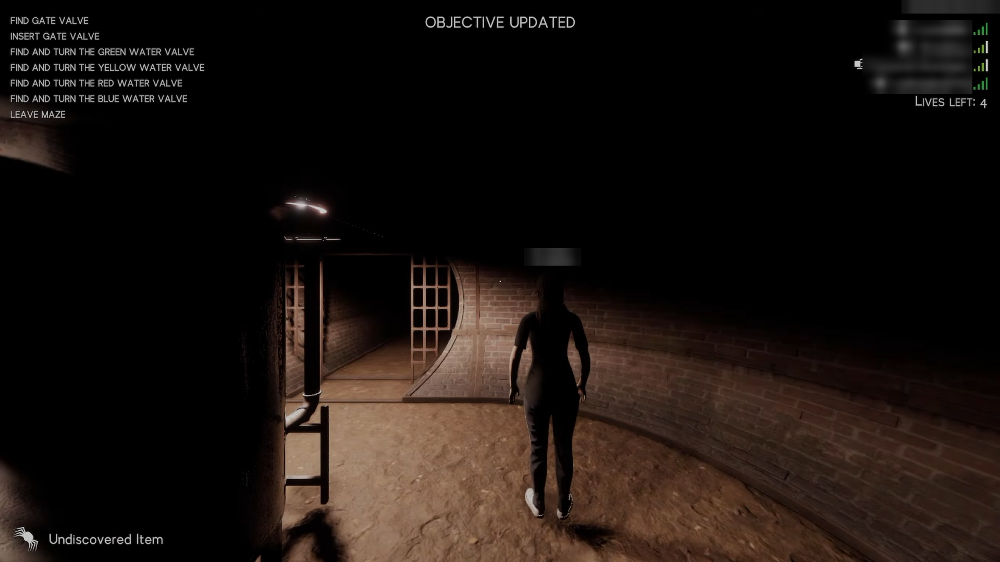
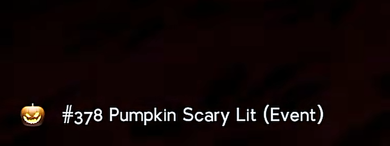
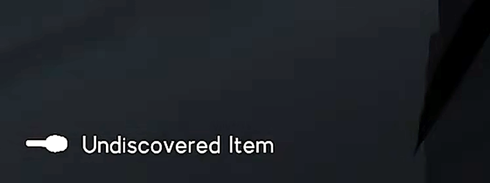
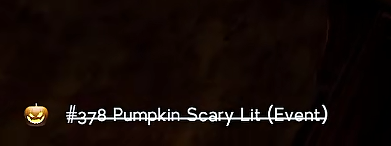
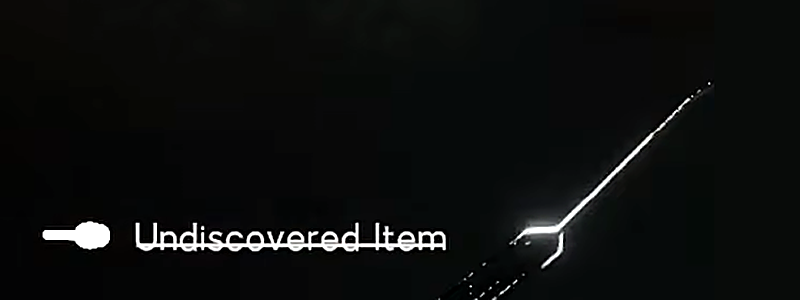
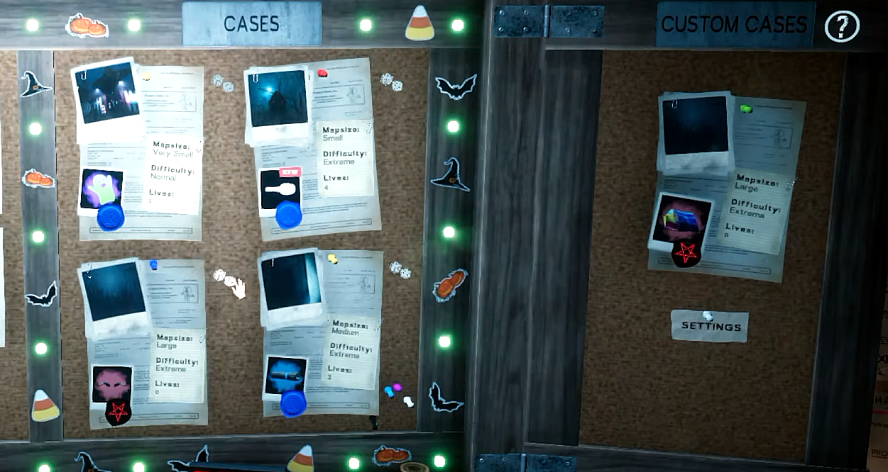
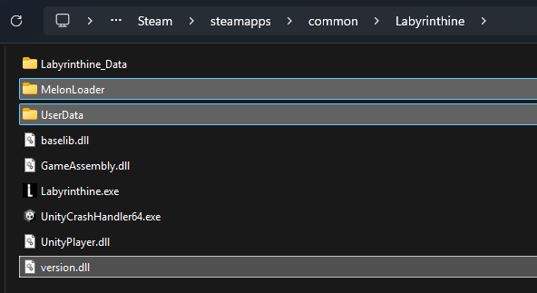
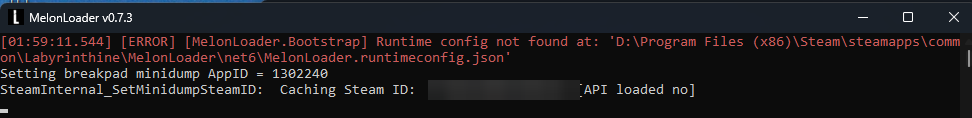

# Labyrinthine - Tell Me Cosmetics
Know which cosmetic a map has **before** you find it.

- **In a maze:** press `Tab` to see the cosmetic in this map.
- **In the lobby (Beta):** each contract shows the cosmetic it will give.

> [!WARNING]
> Lobby prediction is **Beta** and may have bugs. If the mod causes problems, use the older [v0.1.5](https://github.com/limitbrk/Labyrinthine-TellMeCosmetics/releases/tag/v0.1.5) instead.

> [!CAUTION]
> **Use at your own risk:** This is an unofficial fan-made mod, not affiliated with or supported by the Labyrinthine developers. Mods may cause unexpected bugs, crashes, or save-related issues. If you encounter any problems with this mod, please [report them here](https://github.com/limitbrk/Labyrinthine-TellMeCosmetics/issues/new) rather than contacting the game developers.
>
> **A note on gameplay:** This mod is designed as a convenience tool. Knowing rewards in advance may take away some of the mystery, challenge, and sense of discovery that make the game enjoyable. Since it can spoil the surprise for others, I recommend using it only with friends or in a private lobby with people you know. If you're new to the game, I strongly recommend playing without the mod first to get the best experience and discover everything as the developers intended.

## Examples
### In a maze (press `Tab`)
The item shows at the bottom-left of the screen:



<table>
<tr><th></th><th>Discovered</th><th>Undiscovered</th></tr>
<tr><th>Item</th><td></td><td></td></tr>
<tr><th>Music disc</th><td></td><td></td></tr>
<tr><th>Picked up</th><td></td><td></td></tr>
</table>

- **Undiscovered:** shows only the silhouette and `Undiscovered Item` (when `RevealAllItems=false`).
- **Picked up:** the name is crossed out.

### Contract board in the lobby
> [!WARNING]
> **Beta.** Lobby prediction is new. It may be wrong after a game update or for maze types it has not seen yet. Please report wrong predictions in [Issues](https://github.com/limitbrk/Labyrinthine-TellMeCosmetics/issues/new).



How to read the card under each contract photo:

| You see | Meaning |
|---|---|
| Item picture (polaroid) | This cosmetic will spawn |
| Red `NEW` badge + white silhouette | You have not unlocked this item yet (shown in full when `RevealAllItems=true`) |
| `?` card | The mod does not know this maze type yet. Enter **one map of that type once** to teach it |
| No card | No cosmetic will spawn for this contract |

<details>
<summary>How it works</summary>

- The mod replays the game's maze generation (including failed build attempts) to find the seeds used for the cosmetic roll, so a known maze type gives an exact result.
- Every maze type (DLC Egypt included) is known out of the box for the game version the mod was built against. The mod checks the game version on every launch.
- After a game update, the mod reads each maze's settings and cosmetic pool from the game files in the background on launch (DLC mazes too, when installed).
</details>

## Installation
### With a mod manager
Available on Thunderstore: https://thunderstore.io/c/labyrinthine/p/LimitBRK/TellMeCosmetics/

### Manual
1. Install [MelonLoader](https://melonwiki.xyz) **v0.7.3 or newer**.
2. Download the latest `.dll` from [Releases](https://github.com/limitbrk/Labyrinthine-TellMeCosmetics/releases/latest).
3. Copy the `.dll` into the `Mods` folder in the game folder.

## Uninstall
- **Only this mod:**
  - With a mod manager: remove it on the mod manager's page.
  - Manual install: delete `Mods/TellMeCosmetics.dll`.
- **All mods (clean uninstall):**
  1. If you use a mod manager (Thunderstore Mod Manager), uninstall it first.
  2. Then pick one:
     - In Steam: right-click Labyrinthine → **Properties → Installed Files → Verify integrity of game files**.
     - Or delete these from the game folder: the `MelonLoader` folder, the `UserData` folder (mod settings) and `version.dll`.

       

     You can also delete the `Mods`, `Plugins` and `UserLibs` folders if they exist.

**Check:** if this MelonLoader console window still appears when the game starts, MelonLoader is not fully uninstalled. Delete the files above.



## Settings
Start the game once, then close it. The file `Mods/TellMeCosmetics_config.cfg` is created:
```ini
[Gameplay]
RevealAllItems = false
DebugMazeTests = false
DebugPerfTest = false
```
| Setting | Default | Description |
|---|---|---|
| `RevealAllItems` | `false` | Show every item, including ones you have not discovered |
| `DebugMazeTests` | `false` | Developer only. Compares each maze generation step with the game and logs `MATCH`/`MISMATCH`. Makes map loading slower |
| `DebugPerfTest` | `false` | Developer only. In the lobby, times 100 maze simulations per maze type and logs `⏱️Perf`. The lobby stutters while it runs |

<details>
<summary>Cache files</summary>

Learned data is saved in `UserData/TellMeCosmetics/pool.<mazeType>.txt` (cosmetic pool) and `UserData/TellMeCosmetics.maze.bin` (maze settings per maze type), stamped with the game version. They are rebuilt automatically after a game update. Entering a maze overwrites that maze type with what the game actually holds. With `DebugMazeTests` on, entering a maze also logs `🧪Preload ... MATCH/MISMATCH` comparing the preloaded values with the game's.
</details>

### (Optional) Hide MelonLoader windows
Add to the game's Steam launch options:
```yaml
--melonloader.disablestartscreen --melonloader.hideconsole
```
- `--melonloader.disablestartscreen`: hide the MelonLoader splash screen
- `--melonloader.hideconsole`: hide the console window (logs are still saved)

## Status
- **Beta** — lobby contract prediction
- Tested only on **Windows 11 AMD x64**

### Features
- [x] Show the cosmetic item in the Labyrinth map
- [x] Show the item name instead of the item ID
- [x] Show the item image
- [x] Mask locked items (non-OP mode)
- [x] Mark the UI when an item is picked up
- [x] Show the item from the lobby contract, without loading the map (Beta)
- [x] Tweak UI
- ~~Fade in/out animation~~ _(cancelled)_

### Known issues
- MelonLoader makes the game take long to launch.
- Minor lag or freeze when a player joins.

<details>
<summary>Fixed issues</summary>

- Mod UI disappeared when the lobby was recreated
- Disc showed the wrong item name
  
- Occasional crash
- Frame drop / freeze when loading a map
- MelonLoader caused a Steam UI bug (fixed in ML v0.6.6)
</details>

<sub>🤖 **AI disclosure:** lobby prediction, game-file reading and performance fixes were written with help from an AI coding assistant (Claude). The author designed, reviewed and tested them in-game. All images are real in-game screenshots.</sub>

&nbsp;

# Contribution
Here are details if you want to continue my work ;)

## Dev Requirement
- **ModLoader:** [MelonLoader](https://melonwiki.xyz) v0.7.3+
- **AssetSearch:** [UnityExplorer (Forked)](https://github.com/GrahamKracker/UnityExplorer) - Original not worked
- **RevEngCode:** [dnSpy](https://github.com/dnSpy/dnSpy)
- .Net SDK 6.0

## Build It Yourself
1. **Assembly file:** Copy these files `MelonLoader` folder to repo `dlls`
```cs
- MelonLoader\Il2CppAssemblies\Assembly-CSharp.dll
- MelonLoader\Il2CppAssemblies\Il2Cppmscorlib.dll
- MelonLoader\Il2CppAssemblies\Il2CppSystem.Core.dll
- MelonLoader\Il2CppAssemblies\Il2CppBehaviorDesigner.Runtime.dll
- MelonLoader\Il2CppAssemblies\Unity.TextMeshPro.dll
- MelonLoader\Il2CppAssemblies\UnityEngine.CoreModule.dll
- Labyrinthine\MelonLoader\net6\Il2CppInterop.Runtime.dll
```
2. build at repo root by this command
```bash
$ dotnet build
```
3. You will get file at `bin\Debug\net6.0\TellMeCosmetics.dll` that can be copy to game `Mods` folder
 
## Knowledge Sharing
### Contract in "Lobby_PC" scene
`Il2CppRandomGeneration.Contracts.ContractUI` (UI)
`Il2CppRandomGeneration.Contracts.Contract` (data)
- Seed 
- SecondSeed
- ExcludedCustomizationItemIDs

### Cosmetic Item (Lobby)
`Il2CppCharacterCustomization.CustomizationItem`
- icon (Image)
- itemID (Reference ItemID)

### Cosmetic Item (In-game)
`Il2CppCharacterCustomization.CustomizationPickup`
- itemID (Reference ItemID)

### Optional - Save Check 
`Il2CppCharacterCustomization.CustomizationSave`
- IsItemUnlocked(Reference itemID)

### How the game picks the cosmetic
Runs in the maze scene (`RndCustomizationItemsManager.SpawnCustomizationItems` → `RndCustomizationSpawner.Spawn`):
1. **Is there an item?** Yes if `chanceForItem[ContractType] > new Random(SecondSeed).NextDouble()`.
2. **Seasonal event?** If an event is on (not Hardcore), use the event items if `chance > new Random(SecondSeed + 0x12B5).NextDouble()`.
3. **Normal list:** otherwise the list is `globalPrefabs.Value` + the spawner's `possiblePrefabs` (Hardcore uses the `*Hardcore` lists).
4. **Pick one:** `new Random((SecondSeed + 0x23E3 + Seed + 0x692) / 2)` picks by weight, up to 50 tries, skipping `ExcludedCustomizationItemIDs`.

**The catch:** when a maze build fails, the game tries again with new seeds (`Seed += 0x4A3`, `SecondSeed += 0x18C1`). After 10 fails the map grows by 5 and `Seed` resets. So to predict the item, the lobby must know how many builds fail.

### Maze generation (replayed in the lobby)
To count failed builds, `src/Predict` copies the game's maze builder (`MazeGenerator.GenerateMap` → `CreateMaze` → `GenerateNewMaze`):

| File | Step |
|---|---|
| `MazeSim` | layout, start/end |
| `MazeSubmazes` | submazes, transitions |
| `MazeStructures` | landmarks, puzzles |
| `MazeChecks` | exit path (A*), unreachable areas/landmarks, safe zones |
| `MazeWaypoints` | AI waypoints |
| `MazePipeline` | runs all steps in order |

- `MazeCapture` saves each maze type's settings when you enter a maze.
- Each `*Test.cs` compares one step with the game (only when `DebugMazeTests` is on).

### Where maze settings come from
- **`baseline/`:** caches built into the mod. Used only when the game version (and `GameAssembly.dll` size) match.
- **`ScenePreload`:** if the version differs, it reads the settings from `Labyrinthine_Data/level*` at startup with AssetsTools.NET (comes with MelonLoader). The game files have no type trees, so `Il2CppLayouts` gets each script's field layout from il2cpp reflection.
- **DLC mazes** are Addressables scenes. `ScenePreload` finds the scene from its key in `MazeTypesConfigSO` using `StreamingAssets/aa/catalog.json` and the bundle's `AssetBundle.m_SceneHashes`, then reads it from the bundle.

**Update `baseline/` for a new game version:**
1. Launch the game and enter each DLC maze once.
2. Copy `UserData/TellMeCosmetics.maze.bin` and `UserData/TellMeCosmetics/pool.*.txt` into `baseline/`.


### Performance Test Result
Time for `ScenePreload` to read each maze type's data (`ReadAll` → `ReadScene`), measured offline on game 1.0.3 (6 runs; Ryzen 7 7735HS, 32 GB RAM, NVMe SSD). All 21 results matched `baseline/`.

| Maze type | Map | First run (ms) | Median (ms) |
|---|---|---|---|
| 0 | Maze_A | 1943 | 1319 |
| 1 | Maze_B | 805 | 785 |
| 2 | Maze_C | 868 | 864 |
| 3 | Maze_D | 74 | 74 |
| 4 | Maze_E | 164 | 168 |
| 5 | Maze_F | 919 | 945 |
| 6 | Maze_G | 1480 | 1409 |
| 7 | Maze_H | 1055 | 1009 |
| 8 | Maze_I | 165 | 159 |
| 9 | Maze_J | 84 | 87 |
| 10 | Maze_K | 175 | 157 |
| 11 | Maze_L | 838 | 780 |
| 12 | Maze_M | 103 | 100 |
| 13 | Maze_N | 85 | 80 |
| 14 | Maze_O | 87 | 90 |
| 15 | Maze_P | 408 | 406 |
| 16 | Maze_Backrooms | 815 | 780 |
| 17 | Maze_Q | 86 | 85 |
| 18 | Maze_R | 97 | 94 |
| 19 | DLC_Egypt_A | 90 | 84 |
| 20 | DLC_Egypt_B | 73 | 64 |
| **Total** | | **10821** | **9692** |

- Maze_A also loads the shared asset files used by the other maps.
- Runs on a background thread at startup and only when the game version does not match `baseline/`. The log shows the time per maze type: `Preload: ... per maze type [...]`.
