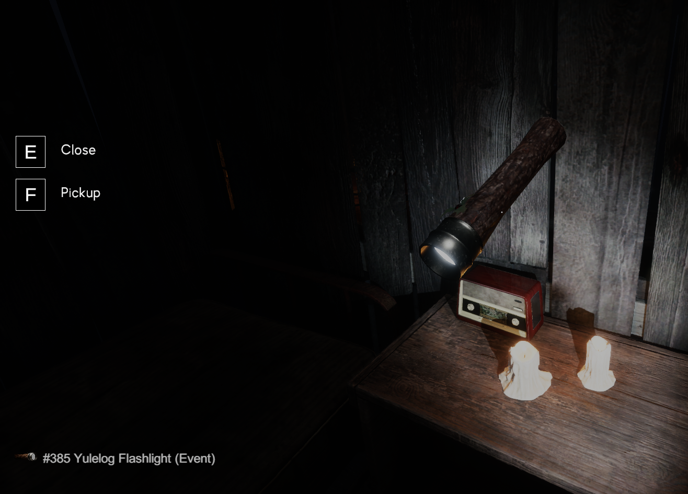
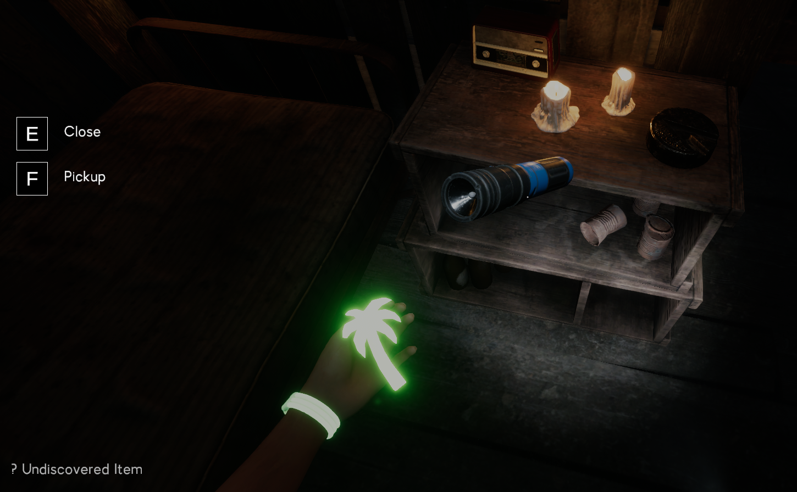
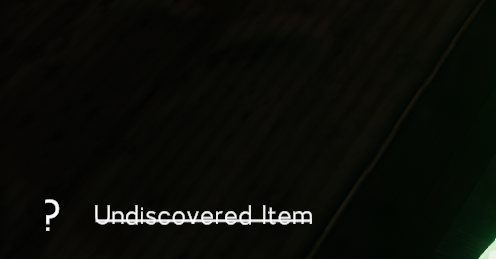
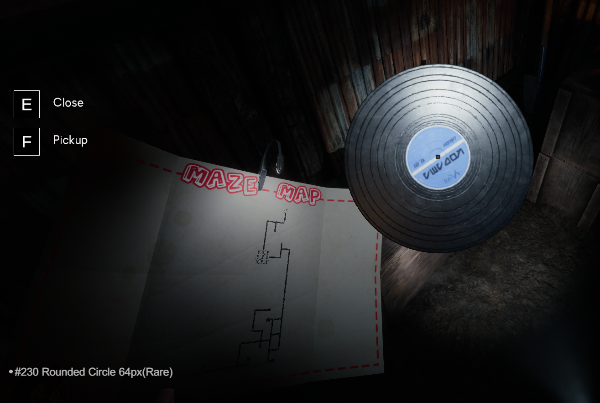

# Labyrinthine - Tell Me Cosmetics
`Press Tab` to display what cosmetics will get in-game.
### Case: Discovered item

### Case: Discovered music item

### Case: Undiscovered item when `RevealAllItems=false`

### Case: When picked up

### Case: Contract board in the lobby
Every contract shows `Cosmetic: <item>` (or `Cosmetic: none` when no cosmetic will spawn) before you start it.
- Enter **one map of each maze type once** so the mod can learn that maze's generation settings. Until then the line ends with ` ?`, meaning the prediction assumes the maze builds on its first attempt.
- After that, the prediction is exact: the mod replays the game's maze generation (including failed build attempts) to find the seeds the cosmetic roll will use.


## Installation
### With Mod Manager
Avaliable in ThunderStore.io https://thunderstore.io/c/labyrinthine/p/LimitBRK/TellMeCosmetics/
### No-Mod Manager 
1. Download and install [MelonLoader](https://melonwiki.xyz) (Must v0.7.0+)
2. Download the latest mod `.dll` [RELEASE](https://github.com/limitbrk/Labyrinthine-TellMeCosmetics/releases/latest) (Recommend latest)
3. Copy `.dll` into the folder `Mods` in the game folder.


## Mod Setting
When game started onces. Please close game. Then file `Mods/TellMeCosmetics_config.cfg` will created with these setting
```ini
[Gameplay]
RevealAllItems = false
DebugMazeTests = false
```
- `RevealAllItems`: Show every item name, including undiscovered items. (Default is `false`)
- `DebugMazeTests`: Developer option. Compares every maze generation step of the mod against the game and logs `MATCH`/`MISMATCH`, slowing map loading. (Default is `false`)

Learned data is cached in `UserData/TellMeCosmetics.pool.txt` (cosmetic pool) and `UserData/TellMeCosmetics.maze.bin` (maze settings per maze type). Delete them to relearn after a game update.

&nbsp;

(Optional) to hide **MelonLoader** process you can set Launch Option as...
```yaml
--melonloader.disablestartscreen --melonloader.hideconsole
```

  - `--melonloader.disablestartscreen`: Disable Melon Loader Splash Screen
  - `--melonloader.hideconsole`: Disable Console Popup (Still save logs)

## Mod Status
**ONLY Tested on Windows 11 AMDx64** 

## Features Plan
- [x] **Display Case's Cosmetics item** - From ~~Cases board~~ Labyrinth Map
- [x] **Show Item Name** - Display the actual item name instead of the item ID.
- [x] **Show Image of Cosmetics Item** - only item name don't know how it's look
- [X] **Masked Locked Items** - For Non-OP mods
- [X] **Mark UI when an item is picked up** -  to help users track their progress.
- ~~**(Cancelled) Tweak UI** - more readable~~ _(I'm lack Unity UI skill to made this)_
- ~~**(Cancelled) Animation** - Fade in / out?~~ 
- [x] **GetItem from Lobby** - Know the item from the contract seeds without loading the world

## Known Issues
I'm not a Unity developer but I tried to search solution
- MelonLoader launch game too long...
- Minor lag or freeze when a player joins the game.
- ~~(Fixed) Mod's UI __Dissapeared__ when Recreated lobby~~
- ~~(Fixed) Disc show wrong itemname~~

- ~~(Fixed) Sometimes Crash~~
- ~~(Fixed) FrameDrop/Freezing sometimes when load map~~
- ~~(Fixed in ML v0.6.6) MelonLoader Make SteamUI Bug~~

&nbsp;
&nbsp;
# Contribution
Here are details if you want to continue my job ;)

## Dev Requirement
- **ModLoader:** [MelonLoader](https://melonwiki.xyz) v0.6.6+
- **AssetSearch:** [UnityExplorer (Forked)](https://github.com/GrahamKracker/UnityExplorer) - Original not worked
- **RevEngCode:** [dnSpy](https://github.com/dnSpy/dnSpy)
- .Net SDK 6.0

## Build It Youself
1. **Assembly file:** Copy these files `MelonLoader` folder to repo `dlls`
```cs
- MelonLoader\Il2CppAssemblies\Assembly-CSharp.dll
- MelonLoader\Il2CppAssemblies\Il2Cppmscorlib.dll
- MelonLoader\Il2CppAssemblies\Il2CppSystem.Core.dll
- MelonLoader\Il2CppAssemblies\Il2CppBehaviorDesigner.Runtime.dll
- MelonLoader\Il2CppAssemblies\Unity.TextMeshPro.dll
- MelonLoader\Il2CppAssemblies\UnityEngine.CoreModule.dll
- Labyrinthine\MelonLoader\net6\Il2CppInterop.Runtime.dll
```
2. build at repo root by this command
```bash
$ dotnet build
```
3. You will get file at `bin\Debug\net6.0\TellMeCosmetics.dll` that can be copy to game `Mods` folder
 
## Knowledge Sharing
### Contract in "Lobby_PC" scene
`Il2CppRandomGeneration.Contracts.ContractUI` (UI)
`Il2CppRandomGeneration.Contracts.Contract` (data)
- Seed 
- SecondSeed
- ExcludedCustomizationItemIDs

Cosmetic selection (maze scene, `RndCustomizationItemsManager.SpawnCustomizationItems` → `RndCustomizationSpawner.Spawn`):
1. Spawn only if `chanceForItem[ContractType] > new Random(SecondSeed).NextDouble()`
2. Not Hardcore + active seasonal event: use seasonal prefabs if `chance > new Random(SecondSeed + 0x12B5).NextDouble()`
3. Otherwise pool = `globalPrefabs.Value` + spawner `possiblePrefabs` (Hardcore: the `*Hardcore` versions)
4. `rnd = new Random((SecondSeed + 0x23E3 + Seed + 0x692) / 2)`; weighted pick up to 50 times, skipping `ExcludedCustomizationItemIDs`
- Each failed maze build attempt shifts seeds (`Seed += 0x4A3`, `SecondSeed += 0x18C1`); after 10 failures the map grows by 5 and `Seed` resets.

Maze generation (`MazeGenerator.GenerateMap` → `CreateMaze` → `GenerateNewMaze`) is ported in `src/Predict` so the lobby can count failed attempts:
`MazeSim` (layout, start/end), `MazeSubmazes` (submazes, transitions), `MazeStructures` (landmarks/puzzles),
`MazeChecks` (exit A*, unreachable areas/landmarks, safezones), `MazeWaypoints` (AI waypoints), chained by `MazePipeline`.
Scene settings are captured per maze type by `MazeCapture`; each `*Test.cs` harness compares one step with the game when `DebugMazeTests` is on.

### Cosmetic Item (Lobby)
`Il2CppCharacterCustomization.CustomizationItem`
- icon (Image)
- itemID (Reference ItemID)

### Cosmetic Item (In-game)
`Il2CppCharacterCustomization.CustomizationPickup`
- itemID (Reference ItemID)

### Optional - Save Check 
`Il2CppCharacterCustomization.CustomizationSave`
- IsItemUnlocked(Reference itemID)
