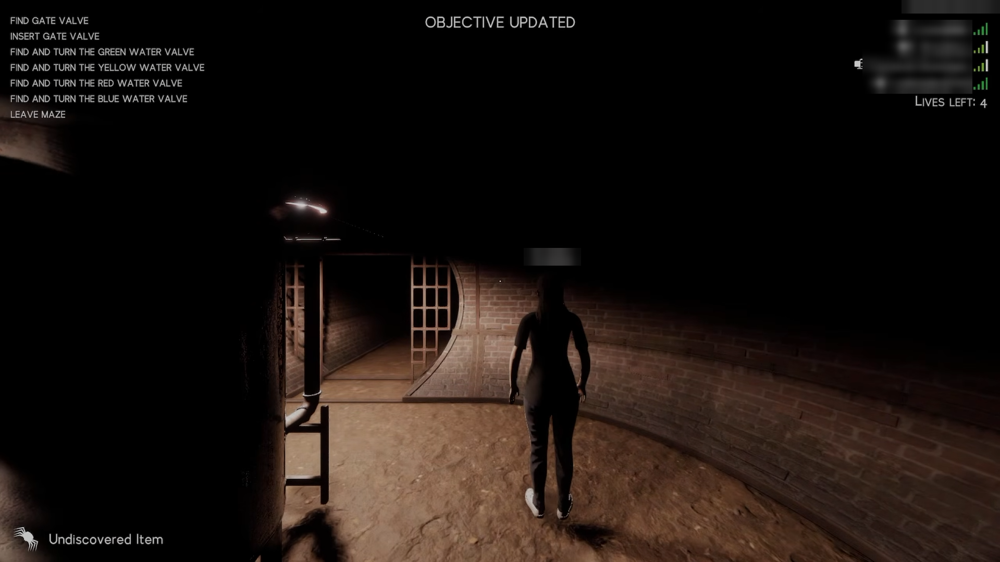
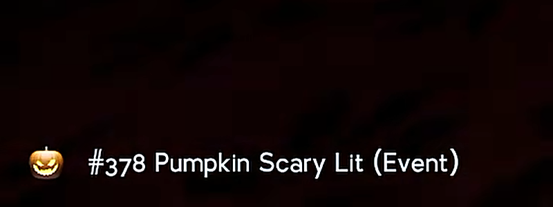
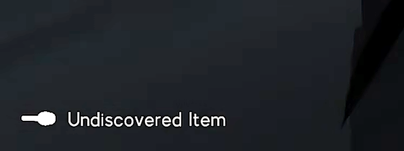
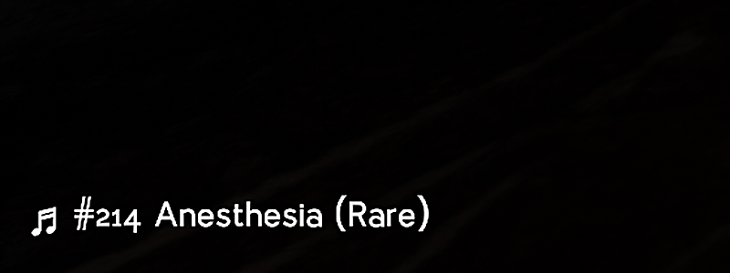
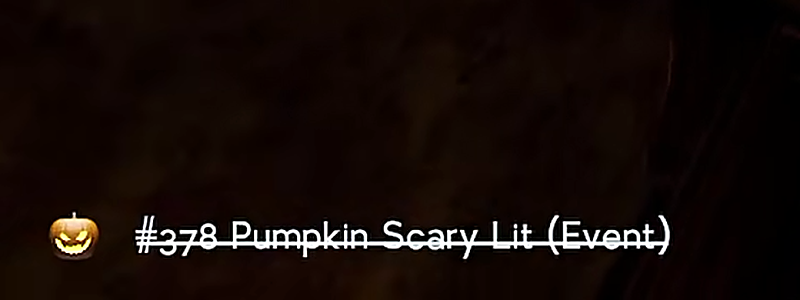
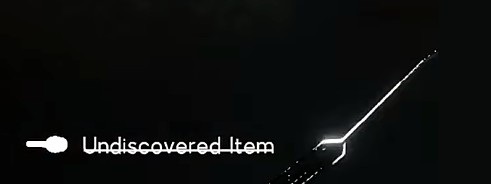
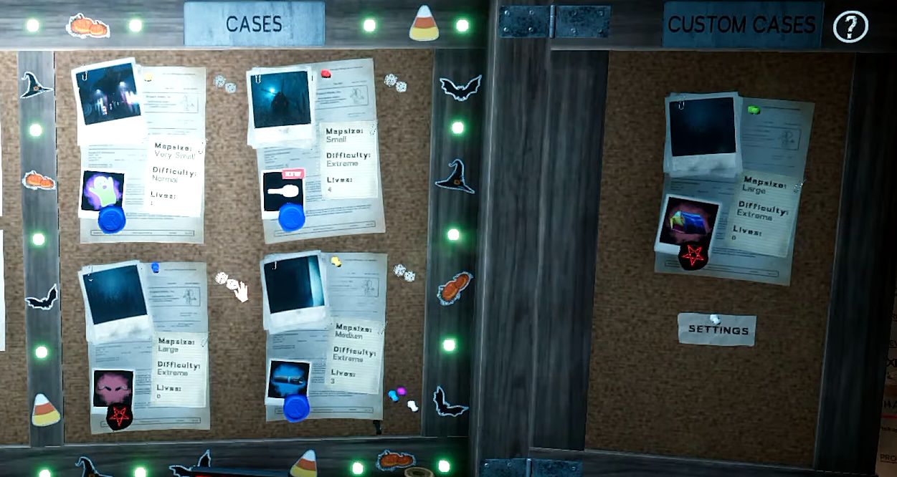

# Labyrinthine - Tell Me Cosmetics
Know which cosmetic a map has **before** you find it.

- **In a maze:** press `Tab` to see the cosmetic in this map.
- **In the lobby (Beta):** each contract shows the cosmetic it will give.

> **⚠️ Beta:** Lobby prediction may have bugs. If the mod causes problems, use the older [v0.1.5](https://github.com/limitbrk/Labyrinthine-TellMeCosmetics/releases/tag/v0.1.5) instead.

## Examples
### In a maze (press `Tab`)
The item shows at the bottom-left of the screen:



| | Discovered | Undiscovered |
|---|---|---|
| **Item** |  |  |
| **Music disc** |  |  |
| **Picked up** |  |  |

- **Undiscovered:** shows only the silhouette and `Undiscovered Item` (when `RevealAllItems=false`).
- **Picked up:** the name is crossed out.

### Contract board in the lobby (Beta)


How to read the card under each contract photo:

| You see | Meaning |
|---|---|
| Item picture (polaroid) | This cosmetic will spawn |
| Red `NEW` badge + white silhouette | You have not unlocked this item yet (shown in full when `RevealAllItems=true`) |
| `?` card | The mod does not know this maze type yet. Enter **one map of that type once** to teach it |
| No card | No cosmetic will spawn for this contract |

Wrong prediction? Please report it in [Issues](https://github.com/limitbrk/Labyrinthine-TellMeCosmetics/issues).

## Installation
### With a mod manager
Install with r2modman / Thunderstore Mod Manager. MelonLoader is installed for you.

### Manual
1. Install [MelonLoader](https://melonwiki.xyz) **v0.7.3 or newer**.
2. Copy `TellMeCosmetics.dll` into the `Mods` folder in the game folder.

## Settings
Start the game once, then close it. The file `Mods/TellMeCosmetics_config.cfg` is created:
```ini
[Gameplay]
RevealAllItems = false
DebugMazeTests = false
```
| Setting | Default | Description |
|---|---|---|
| `RevealAllItems` | `false` | Show every item, including ones you have not discovered |
| `DebugMazeTests` | `false` | Developer only. Compares each maze generation step with the game and logs `MATCH`/`MISMATCH`. Makes map loading slower |

### (Optional) Hide MelonLoader windows
Add to the game's Steam launch options:
```
--melonloader.disablestartscreen --melonloader.hideconsole
```

## Known issues
- MelonLoader makes the game take long to launch.
- Minor lag or freeze when a player joins.
- Tested only on **Windows 11 AMD x64**.

## Changelog
See the [GitHub Releases](https://github.com/limitbrk/Labyrinthine-TellMeCosmetics/releases).

---
<sub>🤖 **AI disclosure:** lobby prediction, game-file reading and performance fixes were written with help from an AI coding assistant (Claude). The author designed, reviewed and tested them in-game. All images are real in-game screenshots.</sub>
